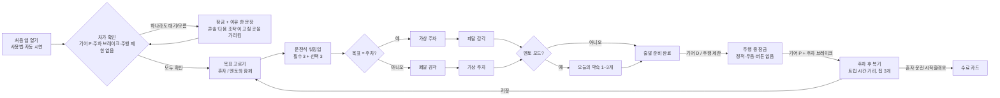

# 11. 서비스 플로우 · UX 리뷰 · 개선점

> TL;DR — 웹 프로토타입(`web/`, 2026-11-04)으로 전체 흐름을 직접 돌려 보고 정리했다.
> 뼈대(안전 게이트 → 연습 전 5분 → 주행 중 잠금 → 연습 후 3분)는 규칙대로 동작한다.
> 가장 큰 약점: ① 준비 단계가 길어 '5분' 약속을 넘기기 쉽고 ② 목표·멘토 선택이 이후 화면에 거의 반영되지 않고 ③ 주행 중 연습에 대해 앱이 아는 게 트립 숫자뿐이라 복기가 얇다.
> 이번에 ①을 일부 고쳤다(목표별 순서, 선택 미션 한 번에 넘기기, 자동 시연). 나머지는 §5 우선순위대로.

---

## 1. 큰 흐름 (사용자 여정)

준비 단계 어디서든:
- 주차 브레이크가 풀리거나 신호를 모르게 되면 → **일시 정지**(하던 곳 유지). 다시 확인되면 같은 미션을 **새 관측부터** 다시 판정.
- 기어 D·주행 제한이 들어오면 → 준비를 건너뛰고 바로 **주행 중 잠금**. 주차하면 복기.

## 2. 화면별 흐름표

| 화면 | 사용자가 원하는 것 | 차가 확인하는 것 | 다음으로 가는 조건 | 예외 처리 | 감정 목표 |
|---|---|---|---|---|---|
| A-1 안전 게이트 | "지금 연습해도 되나?" | 기어 P, 주차 브레이크, 주행 제한 | 셋 다 '확인' → [연습 시작] | 신호 모름·미지원 → 잠금 + 이유 | 안심 |
| A-2 목표 | 오늘 걱정 하나 말하기 | 조수석 착석(멘토 강조) | 목표 + 혼자/멘토 | 지난번 '다음 목표'를 첫 칩으로 | 이해받음 |
| A-3 워밍업 | 조작 위치를 몸으로 익힘 | 벨트·브레이크·방향지시등·와이퍼·전조등·핸들 | 시작 **이후** 새 조작이 관측됨 | 미지원·권한·끊김 → 이유 + 건너뛰기 | "해냈다" |
| A-4 페달 감각 | 살살 밟는 감 | 브레이크 페달 압력 | 20~35%에서 2초 | 미지원 → 건너뛰기 | 뿌듯함(지난번과 비교) |
| A-5 가상 주차 | 후진 주차 기준점 | 핸들 각도(있으면) | 차체 중심 ±0.35m, 방향 ±6° | 옆 차 접촉 → 멈추고 '반대로 조금' | 자신감 |
| A-6 약속 | 옆자리 말투 맞추기 | — | 1~3개 선택 | — | 다툼 줄이기 |
| A-6b 출발 준비 | 오늘 한 것 정리 | — | 기어 D | 혼자 모드: 동승자 안내 | 준비됨 |
| A-7 잠금 | 화면 신경 끄기 | 주행 제한 | 기어 P + 주차 브레이크 | — | 집중 |
| A-8 복기 | 돌아보고 다음 목표 | 트립 시간·거리 | 다음 목표 선택 → 저장 | 트립 없음 → '앱 기준 시간' | 이어 가고 싶음 |

## 3. 두 사람의 여정과 걸리는 지점

**학습자(초보·장롱면허)**

| 단계 | 생각 | 걸리는 지점(웹판에서 확인) |
|---|---|---|
| 첫 실행 | "이게 뭘 해 주는 앱이지?" | 첫 화면이 바로 체크리스트라 가치 설명이 없다 → 사용법 모달로 보완했지만 실제 차에선 모달을 안 읽는다 |
| 워밍업 | "벨트 이미 맸는데 왜 안 돼?" | 규칙(새 관측만)이 낯설다 → 문구로 안내 중. 처음 1회는 이유를 한 줄 더 보여 주면 좋다 |
| 가상 주차 | "언제 핸들을 돌려?" | 기준선·궤적이 도움이 되지만, 후진 버튼을 7초 넘게 누르고 있어야 한다 |
| 주행 | — | 앱은 아무것도 하지 않는다(의도). 하지만 그래서 복기에 쓸 정보가 트립뿐이다 |
| 복기 | "오늘 잘한 거 맞아?" | 숫자 2개 + 칩 3개. '해냈다'는 배지로만 느껴진다 |

**멘토(가족·지인)**

| 단계 | 생각 | 걸리는 지점 |
|---|---|---|
| 목표 | "나는 뭘 하면 돼?" | 멘토 전용 안내가 없다. 약속 카드 1장이 전부 |
| 주행 | "약속이 뭐였더라" | 잠금 화면에 약속을 띄우면 주행 중 화면 규칙과 충돌 → **출발 준비 화면에서 한 번 더 크게** 보여 주는 것까지만 |
| 복기 | "한마디 해 줘야지" | 칩 5개 중 1개. 칭찬과 다음 과제가 섞여 있다 |

## 4. 리뷰 — 장점과 단점

### 장점
1. **규칙을 코드로 지킨다.** 모르면 잠금, 시작 이후 새 관측만, 출처 라벨, 주행 중 정적 — 웹판 테스트 16개가 Kotlin 테스트 시나리오와 같다.
2. **'확인은 차가'가 화면에서 보인다.** 미션 그림 아래 '차가 읽은 값'(체결/밟음 72% 등)이 실시간으로 바뀐다.
3. **혼자서도 시연된다.** 콘솔 '다음 조작'이 고칠 곳을 노란 테두리로 가리키고, 자동 시연이 1분에 전체 흐름을 보여 준다(영상 녹화·2차 PT용).
4. **실력 판정 없이 성취감.** 배지·레벨은 '한 행동'과 '이어 간 횟수'만 센다. 페달은 '내 기록 비교'로만 보여 준다.
5. **실패라는 말이 없다.** 순서가 틀려도 "거의 다 왔어요. 한 번 더!", 옆 차에 닿으면 "반대로 조금 움직여 볼까요?".

### 단점(솔직하게)
1. **5분 약속이 깨지기 쉽다.** 필수 3 + 선택 3 + 페달 + 주차 + 약속을 다 하면 화면 10개를 거친다. 실제 소요 시간은 아직 재지 않았다(§6에서 측정).
2. **목표 선택의 효과가 약하다.** 이번에 '주차' 목표만 순서를 바꿨다. 나머지 목표는 화면이 같다.
3. **멘토 모드가 얇다.** 약속 카드와 복기 칩 1개뿐.
4. **복기 정보가 얇다.** 주행 중 기록을 하지 않는 원칙 때문에 트립 시간·거리만 있다(주행 습관 리포트는 운영진 확인 후 — PRD §3).
5. **가상 주차 조작이 길고 단조롭다.** 버튼을 오래 눌러야 하고, 시나리오가 후진 주차 1개다.
6. **웹판의 한계.** 모든 신호가 모의다. 실제 차·에뮬레이터 신호, 화면 크기, 조그 다이얼, 성능 기준은 Android 앱에서 확인해야 한다.

## 5. 개선점 — 우선순위

| 순위 | 개선 | 이유 | 상태 |
|---|---|---|---|
| ★1 | 목표별 단계 순서(주차 → 가상 주차 먼저) | 5분 안에 걱정부터 | **웹판 반영** |
| ★1 | 선택 미션 한 번에 넘기기 + 목표 화면에 '약 5분' 표시 | 5분 약속 | **웹판 반영** |
| ★1 | 자동 시연(약 1분, 콘솔 만지면 멈춤) | 영상·PT·심사위원 단독 체험 | **웹판 반영** |
| 2 | 목표별 미션 추천 확장: 출발·정지 → 브레이크·페달 강조, 차선 바꾸기 → 방향지시등 + 미러 위치 찾기 | 목표 선택이 의미 있게 | 다음 |
| 2 | 첫 연습 1회만 "왜 다시 매요?" 한 줄 설명 | 새 관측 규칙이 낯섦 | 다음 |
| 2 | 가상 주차: 속도 2단(천천히/보통), 한 번 탭 = 0.5m 이동 모드 | 오래 누르기 피로 | 다음 |
| 2 | 출발 준비 화면을 멘토용 카드로(약속 크게, 조수석 쪽 정렬) | 멘토 모드 보강, 주행 중 규칙 유지 | 다음(B16과 합침) |
| 3 | 복기에 '오늘 한 것' 타임라인(워밍업·주차·약속 결과 자동 요약) | 숫자 2개보다 '해냈다'가 잘 보임 | 다음 |
| 3 | 평행·전면 주차 시나리오(3번째 연습부터 열림) | 재방문 동기 | B18 |
| 3 | 연습 달력·연속 기록(압박 문구 금지) | 재이용 | 아이디어 창고 |
| 4 | 첫 화면 가치 한 줄("차가 확인해 주는 정차 연습") | 첫 실행 이해 | 문구만 |

## 6. 확인하는 방법(지표)

| 지표 | 목표 | 측정 |
|---|---|---|
| 첫 연습 완주율(게이트 → 출발 준비) | 80% 이상 | 설문 참가자 시연(웹판 자동 시연 제외) |
| 준비 단계 소요 시간 | 중앙값 5분 이하 | 앱 내 시계(기기 안에만 저장) |
| 복기 저장률(주행 후) | 70% 이상 | 기록 수 / 주행 수 |
| "다음에도 쓰겠다" | 4/5 이상 | 설문 Q6 |

> 지표 수치는 목표일 뿐, 측정 전에는 제출 문서에 결과처럼 쓰지 않는다(CLAUDE.md §7).
